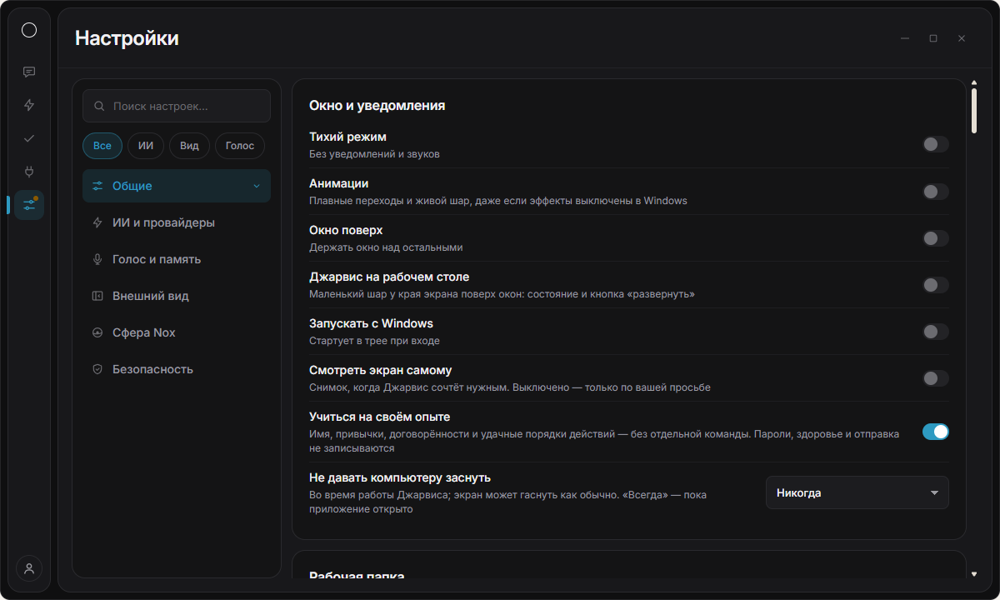
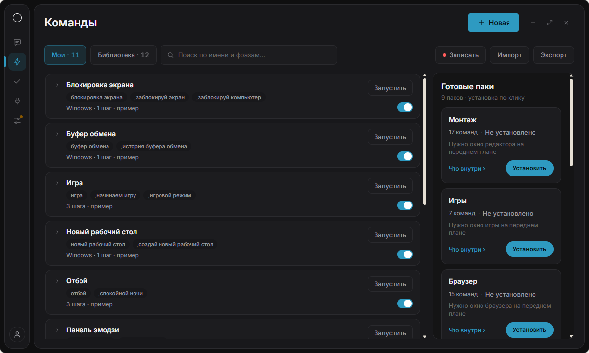
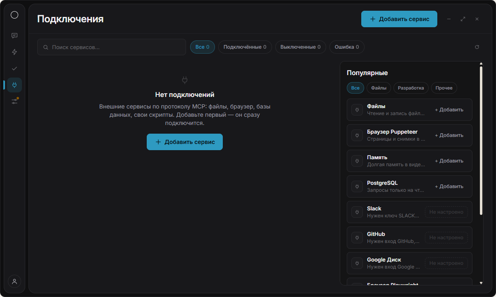
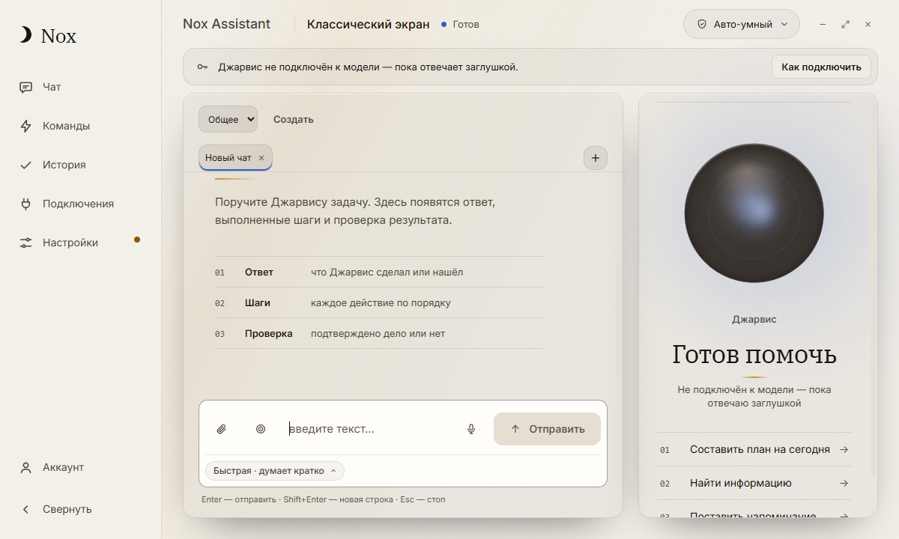
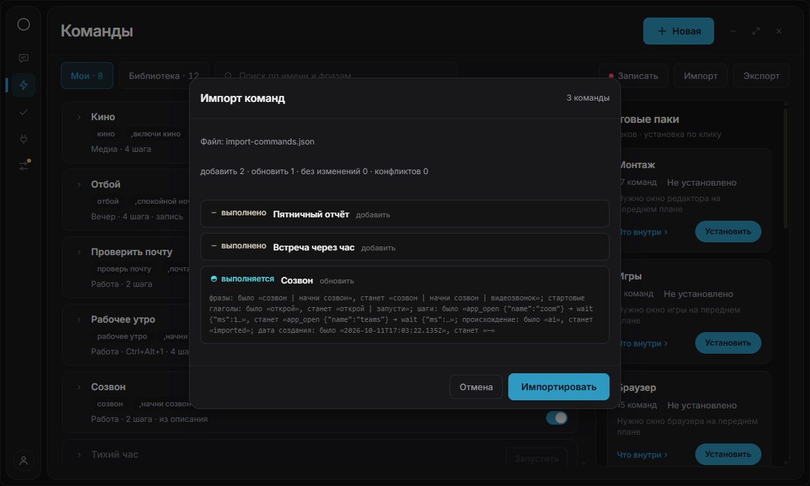
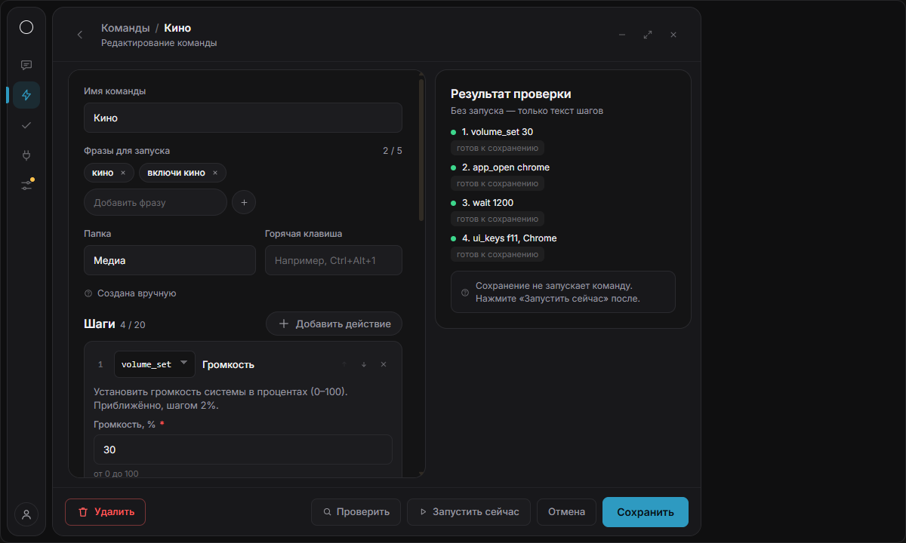

# Визуальный аудит

Проверка настоящего окна Electron. Основные снимки — 1200×720; адаптивные снимки — 960×640 и 1600×900. QA разделов отдельно менял окно на 864×520. Все файлы находятся в `evidence/`.

## Подтверждённые визуальные находки

### ZM-002 — основные разделы не следуют выбранной теме · P1

После выбора «Светлая» глобальный `--bg` становится `#F4F1EB`; меняются глобальные шрифты и акцент. Но `.app` и основное содержимое чата Nox, «Команд», «Подключений» и «Настроек» сохраняют `rgb(15,15,16)`, синий акцент `#2E9AC1` и Inter. В классическом диалоге тот же выбор действительно меняет фон и шрифт. Это не артефакт снимка.

Снимки одного выбора темы в разных разделах:

Для сравнения — классический диалог, который реагирует на тему:

Причина и матрица по 23 темам описаны в [THEME-AUDIT.md](THEME-AUDIT.md). Nox-экраны выглядят как цельная тёмная система между собой, но настройки в общем меню обещают большее, чем эта система применяет.

### ZM-011 — импорт показывает внутреннее описание команды · P2

На карточке обновляемой команды в предпросмотре видны имена действий вроде `app_open`, `wait`, исходные аргументы и старые/новые сериализованные значения. Для владельца, который не пишет команды вручную, это читается как технический дамп; при длинных аргументах текст мелкий и быстро сливается. Предпросмотр должен отвечать, что изменится и что запускается, без обязательного чтения внутренних ключей.

Нативное окно выбора файла в этом визуальном сценарии подменялось фикстурой; настоящий выбор файла и запись на диск не проверялись.

### ZM-012 — редактор команд смещён влево · P3

При ширине 1200 редактор занимает примерно 860 пикселей в рабочей области шириной 1122 и остаётся прижат к левому краю; справа около 260 пикселей пустоты. Само содержимое не обрезано, поэтому это полировка композиции, а не блокирующий дефект. На 960×640 проверялся каталог, не редактор.

## Главное окно и адаптивность

### Сравнение с проектными материалами

Для чата использован видеокадр `IMG_22660` около 12 с из пакета Muse. В окне 864×520 со сферой Wire по свежему снимку чат начинается на x239 и имеет ширину 330 px. В кадре 865×520 он начинается на x264 и имеет ширину 309 px. Объединённая ширина истории и рейки составляет 222 px против 248 px. Правая панель почти совпадает по горизонтальной геометрии, x577 против x579 и ширина 278 px в обоих случаях. Поле ввода имеет размеры 284×76 против 286×88 px и в приложении стоит на 15 px ниже. На снимке Wire хорошо виден светлый экватор, в кадре сетка плотнее и контур менее симметричен. Один кадр не позволяет оценить совпадение анимации. В источнике идёт работа, в проверочном окне загружена сохранённая история. [Пара кадров](evidence/reference-chat-pair-864.png) · [Геометрия Electron](evidence/reference-live-wire-864.json) · [Замеры источника](../../reconstruction/muse/README.md)

| Раздел, 1200×720 | Наблюдение |
|---|---|
| Команды | Каркас и расположение поиска, кнопок и паков сходятся. Карточки в приложении выше, особенно в правой колонке с дополнительными пояснениями. Списки в паре содержат разные команды, а первая строка в макете раскрыта. [Пара](evidence/reference-commands-pair-1200.png) |
| Редактор | Макет использует почти всю рабочую ширину. В приложении блок проверки и нижняя панель заканчиваются до правого края, поля занимают более узкую колонку и меньше шагов видно без прокрутки. Это подтверждает ZM-012. [Пара](evidence/reference-editor-pair-1200.png) |
| Подключения | Сохранились две колонки и фильтры. Рабочие карточки сильнее разделены рамками статуса, ошибки показывают более подробную причину, популярные сервисы требуют вертикальной прокрутки. На обеих сторонах показан непустой список, состав сервисов и состояний различается. [Пара](evidence/reference-connections-populated-pair-1200.png) |
| Настройки | Две колонки и порядок навигации узнаваемы. В приложении категории содержат полноценные списки настроек и больше вертикального пространства на строку. В макете выбрана категория «ИИ и провайдеры», а на снимке приложения «Общие». Сравнение ограничено оболочкой. [Пара](evidence/reference-settings-pair-1200.png) |

Ориентирами для четырёх пар служат проектные PNG Phase 2. Сопоставление проверяет геометрию, плотность и структуру в одинаковом размере. Содержимое карточек, состояние раскрытия, названия и нативные кнопки окна различаются. Оригинальные видеозаписи целиком остаются непроверенными.

Журнал остался на классической оболочке. В 1200×720 у него широкая рейка с текстовыми подписями, логотип с луной и верхняя строка «Nox Assistant / История / Готов». Переход из Nox-чата, команд или настроек меняет эти части окна вместе с оформлением. На 864×520 рейка становится узкой, фильтры переходят на две строки и таблица прокручивается. Это подтверждённый оставшийся фрагмент прежней оболочки. Общий разрыв между оболочками учитывается в ZM-002. [Журнал 1200×720](evidence/electron-temp/journal-window-r1/journal-1200.png) · [Журнал 864×520](evidence/electron-temp/journal-window-r1/journal-864.png)

«Дела» и «Аккаунт» в режиме без сервера тоже используют классическую оболочку с широкой рейкой и луной. В тёмной и светлой теме содержимое помещалось в 1200×720. У «Дел» проверено пустое состояние «Ничего не висит», у «Аккаунта» — пояснение «Вход не нужен». [Дела](evidence/electron-temp/theme-probe-extra-r1/deals-dark-1200-v2.png) · [Аккаунт](evidence/electron-temp/theme-probe-extra-r1/account-light-1200-v2.png)

- Свежий чат на 960×640 показывает «С чего начнём?», поле ввода и сферу; состояние чистое и не перекрывает элементы. Первое знакомство при этом не предлагает примеры поручений или подсказки по навигации. Это наблюдение по UX, не включено в счётчик дефектов.
- Полный чат на 960×640 и 1600×900 сохраняет колонки истории, переписки и сферы. На меньшей ширине история сжимается, но ввод остаётся в окне.
- «Настройки» на 960×640 перестраивают навигацию в горизонтальную панель над прокручиваемым содержимым; «Подключения» скрывают боковую панель популярных сервисов; «Команды» используют всю ширину списка. При 1600×900 основные разделы визуально сохраняют заданную сетку.
- На 864×520 три QA-стенда проверили `scrollWidth` и прокрутку основной панели. Это не заменяет ручную проверку всех длинных подписей и системных масштабов.
- Диалог добавления сервиса на 1200×720 остаётся в окне, поля расположены последовательно, кнопка добавления заблокирована до заполнения. Проверка размеров всех диалогов на всех разрешениях не выполнена.

Снимки разрешений: [чат 960](evidence/nox-full-960.png), [чат 1600](evidence/nox-full-1600.png), [настройки 960](evidence/settings-catalog-960.png), [настройки 1600](evidence/settings-catalog-1600.png), [команды 960](evidence/commands-catalog-960.png), [команды 1600](evidence/commands-catalog-1600.png), [подключения 960](evidence/connections-catalog-960.png), [подключения 1600](evidence/connections-catalog-1600.png).

## Сильные стороны, подтверждённые снимками и QA

- Главное окно, команды, подключения и настройки визуально используют согласованные отступы, границы и радиусы в тёмной теме.
- В диалоге выбора действия длинное описание ограничено прокручиваемой областью, нижняя панель остаётся видимой.
- Панель записи действий объясняет, какие данные не сохраняются, предупреждает о координатах и отделяет отмену от перехода к черновику.
- Состояния подключения различаются не только цветом: есть подпись, значок и действие для каждой фикстуры.

## Не проверено

Hover/focus/disabled в каждом контроле, все пустые и ошибочные экраны, внешний вид уведомления Windows, диалог подтверждения агента с длинными данными, экранный диктор, полный видеоряд, физические DPI и пиксельное сравнение каждого экрана с утверждённым эталоном.
