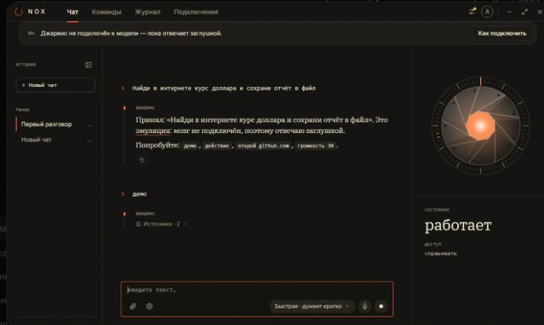
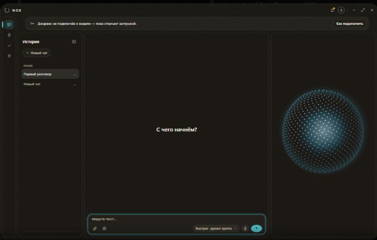
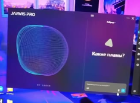
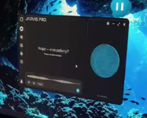

# AETHER / REAL PHOTO REFERENCE MAP

Все четыре изображения получены от владельца в одном сообщении. **Это не сгенерированные концепции** и не изображения из веб-поиска. PDF включает их без подмены.

## 01 — Актуальный интерфейс Nox

- Исходный Nox, вид: узкая история слева, центральный чат, круглая механическая/оранжевая сфера справа.
- Проблемы: много жёстких границ, слабая читаемость сообщений, слишком много пустоты в чате, отдельная зона статуса под сферой.
- Не обязан сохранять нынешнюю сетку. Сохранять функции, не текущую оболочку.

## 02 — Предыдущая версия Nox

- Сфера из сине-бирюзовых точек более выразительная, чем общий уровень тогдашнего чата.
- Положительно: ощущение отдельного живого ассистента.
- Негативно: очень узкий чат, незанятый экран.
- Внимание: пользователь указал, что «точечная» и «синяя» сферы уже есть в проекте. Не путать это с гарантией, что на фото изображены именно два независимых модуля. **Проверить по коду и в Electron.**

## 03 — Jarvis Pro, первое изображение

- Референс визуального баланса между крупной сферой и небольшим блоком общения.
- Ценить лёгкость, а не копировать цвета, логотип, форму сферы, размеры пиксель-в-пиксель.
- Сам снимок малого разрешения и не подходит как источник точной типографики.

## 04 — Jarvis Pro, второе изображение

- Сфера — часть композиции, а не отдельный виджет мониторинга.
- Возможна более свободная организация чата и сферы, без закреплённого 3-column dashboard.
- Снимок небольшого разрешения, не делать на его основе выводов о точных размерах пикселей.

## Что заказчик уже отверг

Три прежних ИИ-концепта с большими отчётами, таблицами, KPI, внешним видом «офисной панели управления», постоянным Nox Live на пол-экрана. **Не использовать** их как желаемые визуальные цели. Они не входят в этот пакет.

## Что считать успехом

Визуальная простота двух референсов Jarvis Pro, функциональная насыщенность реального Nox, более качественный чат, две сохранённые оригинальные сферы, модульный инвентарь, глубокая настройка внешнего вида и новый UI без CSS-пластыря.
